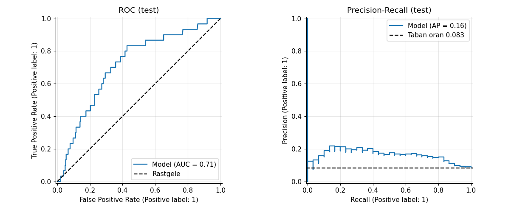
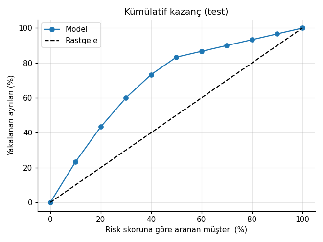
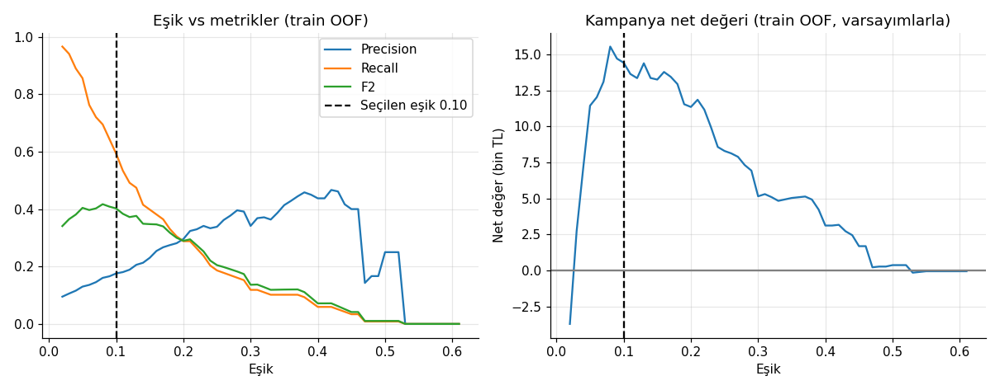

# 📉 Customer Churn Prediction — Uçtan Uca Veri Bilimi Projesi

Bir abonelik şirketinde **müşteri kaybını (churn)** tahmin eden, veri denetiminden API'ye kadar tüm adımları içeren, **tekrar üretilebilir** ve **testli** bir portföy projesi.

> **Dürüst özet:** Veri sentetik ve sinyal zayıf-orta düzeyde. Model rastgeleden belirgin şekilde iyi (test ROC-AUC ≈ 0,71; en riskli %10'luk dilimde lift ≈ 2,3×) ama "mucize" değil. Projenin değeri, **doğru süreç**: sızıntısız Pipeline, kanıta dayalı özellik seçimi, belirsizlik raporlama, iş maliyetine bağlı eşik ve duyarlılık analizi.

## İçindekiler
1. [İş problemi](#1-iş-problemi) · 2. [Veri seti](#2-veri-seti) · 3. [Veri kalitesi sorunları](#3-veri-kalitesi-sorunları-ve-temizleme) · 4. [EDA](#4-eda-bulguları) · 5. [İstatistiksel analiz](#5-i̇statistiksel-analiz) · 6. [Feature engineering](#6-feature-engineering-dürüst-sonuç) · 7. [Modeller](#7-modeller) · 8. [Değerlendirme](#8-model-değerlendirme) · 9. [İş önerileri](#9-iş-önerileri) · 10. [Deployment](#10-deployment) · 11. [Sınırlılıklar](#11-sınırlılıklar) · 12. [Çalıştırma](#12-nasıl-çalıştırılır) · 13. [Yapı](#13-proje-yapısı)

## 1. İş problemi
Her ay müşteri kaybeden bir şirket, **ayrılma ihtimali yüksek müşterileri önceden bulup** sınırlı bütçeyle elde tutma kampanyası yapmak istiyor. Hedef `churn` (0/1) → **ikili sınıflandırma**; çıktı bir **risk skoru** (kampanya öncelik sırası).
Başarı: PR-AUC / ROC-AUC (sıralama), Recall–Precision (operasyon) ve **kampanya net değeri (TL)** (iş).
> Accuracy ana metrik **değil**: herkese "kalır" diyen model %91,7 Accuracy alır ve tek ayrılanı bulamaz.

## 2. Veri seti
`data/raw/customer_churn_raw.csv` — 1.820 satır, 16 sütun (sentetik). Veri sözlüğü: `data/raw/data_dictionary.csv`. Temizleme sonrası **1.800 müşteri, 148 ayrılan (%8,22; %95 GA: %7,04–%9,58)**.
`data/reference/customer_churn_clean_reference.csv` yalnızca **temizleme kodunu doğrulamak** için kullanılır; model eğitiminde **kullanılmaz**.

## 3. Veri kalitesi sorunları ve temizleme
Ham veriyi değiştirmeden (`copy`) `src/data_cleaning.py` ile temizlenir; her adım `reports/cleaning_log.csv`'ye yazılır.

| # | Sorun | Çözüm |
|---|---|---|
| 1 | Ücret metin (`free`, `?`, `399TL`…); aralık dışı (−100, 9999, 0) | Sayıya çevir, aralık dışını ele, **ücret = plan fiyatı × (1 − indirim)** kuralıyla geri kazan (33 hücre) |
| 2 | **`399TL` sayıya çevrilebilir ama yanlış** (Premium+%20 indirim → 479,2) | Kural çapraz kontrolü yakaladı → kuralla değiştirildi |
| 3 | **5 satırda plan etiketi ücretle çelişiyor** (plan `basic`, ücret/indirim Premium/Standard fiyatı) | Alanlar arası tutarlılık kuralıyla plan düzeltildi |
| 4 | Aralık dışı: yaş (6), kullanım (4), memnuniyet (2) | `NaN` yap; doldurma Pipeline'da (sızıntı olmasın) |
| 5 | Büyük/küçük harf tutarsızlığı (29 hücre) | Standartlaştırma |
| 6 | 12 birebir tekrar | Silindi |
| 7 | **8 müşteri, aynı ID farklı bilgi** | Hepsini silmek 1.792'ye düşürürdü (8 gerçek müşteri kaybı). **İlk kayıt tutuldu** (*varsayım*; zaman damgası yok) + `conflicting_customers.csv` |

Doğrulama (referans dosyayla): plan, ücret, yaş, kullanım, memnuniyet, hedef **0 farkla** eşleşiyor. Kalan **15 hücre** (27.000'in %0,056'sı) tespit edilemeyen hata: küçük harfle yazılmış `region/contract/payment` hücrelerinin bir kısmının *değeri* de yanlış (kural yakalayamaz).

## 4. EDA bulguları
En güçlü ayırıcılar: **sözleşme türü** (Aylık %11,9 vs Yıllık %4,3 vs İki yıllık %2,7), **abonelik süresi** (0-6 ay %15,4 → 49-72 ay %4,2), **memnuniyet**, **şikâyet/destek**. Cihaz, ödeme yöntemi, yaş, kullanım saati ayırt edici değil. Tüm bireysel korelasyonlar zayıf (|r| ≤ 0,14) → makul model başarısı orta düzey.

## 5. İstatistiksel analiz
Wilson GA, ki-kare + Cramér's V, Mann-Whitney + rank-biserial, **Benjamini-Hochberg düzeltmesi**, Fisher exact (eksiklik testi), statsmodels lojistik regresyon (odds ratio). Örn: diğerleri sabitken Aylık sözleşme, Yıllığa göre odds'u **≈2,9×** artırır (%95 GA 1,8–4,6). `plan` ve `region` etkisi çoklu test düzeltmesinden sonra anlamlı **değil**. `monthly_fee_tl`, plan ve indirimden **tam türediği** (R²=1) için modelde yok.

## 6. Feature engineering (dürüst sonuç)
`tenure_group`, `has_late_payment`, `has_support_contact`, `has_complaint`, `total_issues_6m` üretildi ve **CV ile test edildi**:

| Özellik seti | PR-AUC (CV ± std) |
|---|---|
| base (tüm ham, ücret hariç) | 0,244 ± 0,069 |
| engineered (base + üretilenler) | 0,240 ± 0,065 |
| **core (5 değişken)** | **0,267 ± 0,067** |

Üretilen özellikler **ölçülebilir katkı sağlamadı**; fark gürültü bandında. Karar kuralı: eşitse **en sade** seti seç → **core**: `tenure_months, satisfaction_score, complaints_6m, support_calls_6m, contract_type` (eğitim verisinde BH düzeltmesinden sonra anlamlı kalanlar).

## 7. Modeller
Tek `Pipeline`: `add_features → impute → scale/one-hot → model` (sızıntısız). Eğitim verisinde 5×3 tekrarlı stratified CV + küçük grid araması, ölçüt PR-AUC:

| Model | PR-AUC | ROC-AUC | Brier (düşük = iyi kalibrasyon) |
|---|---|---|---|
| Dummy | 0,082 | 0,500 | 0,075 |
| **Logistic Regression** | **0,267** | 0,748 | **0,069** |
| Logistic Regression (balanced) | 0,265 | 0,746 | 0,201 |
| Decision Tree | 0,208 | 0,691 | 0,205 |
| Random Forest | 0,275 | 0,735 | 0,180 |
| Hist Gradient Boosting | 0,245 | 0,728 | 0,187 |

**Seçim: 1-standart-hata kuralı** — en iyiden 1 SE içindeki modeller arasından en sadesi (eşitse en iyi kalibre olan): **Lojistik Regresyon**. `class_weight="balanced"` olasılıkları şişirir (ort. tahmin %41, gerçek %8); bu yüzden dengesizlik **eşikle** ele alındı.

## 8. Model değerlendirme
Test kümesi (360 müşteri, **yalnızca 30 ayrılan**) **tek seferlik** açıldı.

| Metrik | Değer (%95 bootstrap aralığı) |
|---|---|
| ROC-AUC | 0,715 (0,62 – 0,80) |
| PR-AUC (taban oran 0,083) | 0,164 (0,11 – 0,27) |
| Eşik 0,10: Recall / Precision | 0,60 (0,42–0,78) / 0,16 (0,10–0,24) |
| Aranan müşteri oranı | %30,6 |
| Lift (en riskli %10) | 2,3× |




**Eşik iş değerine göre seçildi** (eğitim verisinin out-of-fold tahminlerinde; varsayımlar `src/config.py`). **Sonuç maliyet varsayımına çok duyarlıdır:**

| Kampanya maliyeti (TL) | Eşik | Aranan % (test) | Recall | Test net değer (TL) | Herkesi arasak (TL) |
|---|---|---|---|---|---|
| 20 | 0,03 | 69,7 | 0,90 | +7.731 | +7.008 |
| **50 (varsayılan)** | **0,10** | **30,6** | **0,60** | **+2.962** | **−3.792** |
| 100 | 0,20 | 9,2 | 0,23 | −141 | −21.792 |
| 150 | 0,37 | 1,7 | 0,00 | −900 | −39.792 |



Dürüst yorum: ucuz/dijital aksiyonlarda model değer katıyor; pahalı aksiyonlarda yeterince keskin değil. **Out-of-fold + hold-out skorlarına göre** risk kademeleri tek yönlü ayrışıyor: High (müşterilerin %28'i) gerçek churn **%17,3** ve tüm ayrılanların **%59,5'i**; Medium %8,1; Low %2,7.

## 9. İş önerileri
1. **Aylık sözleşmeli, kısa süreli, düşük memnuniyetli** müşteriler için yıllık sözleşmeye geçiş teklifi (**A/B testiyle** ölçülerek).
2. Şikâyet açan müşterilere proaktif çözüm süreci.
3. Kampanyayı **düşük maliyetli kanallarla** (SMS/e-posta/uygulama içi) yürütmek; pahalı aramalar için daha ayırt edici veri/model gerekir.
4. Veri toplama: işlem **zaman damgası**, ayrılma **nedeni**, kampanya geçmişi, rakip/fiyat verisi.

## 10. Deployment
* **FastAPI** (`api.py`): `/health`, `/model-info`, `/predict`, `/predict/batch`; Pydantic ile doğrulama (geçersiz girdi → 422).
* **Streamlit** (`app.py`): tek müşteri, toplu CSV, model hakkında.
* Model dosyası **tüm Pipeline'ı** (özellik üretimi dahil) içerir → eğitim/servis dönüşümleri aynıdır.
* **SQL** (`sql/churn_analysis.sql`): CTE, `RANK`, `NTILE`, kümülatif pencere toplamı; **Power BI** rehberi `docs/04_POWERBI_REHBERI.md`.

## 11. Sınırlılıklar
* **Veri sentetik**; gerçek davranışı temsil etmez.
* Yalnızca 148 ayrılan; test'te 30 → metrikler oynak (aralıklar geniş).
* Çelişkili ID kuralı bir **varsayım**; plan düzeltmesi alanlar arası kurala dayanır.
* Korelasyon ≠ nedensellik; kampanya etkisi **A/B testi** olmadan bilinemez.
* Maliyet/marj rakamları **varsayımdır**.
* Zamansal doğrulama yok (tek kesit veri).

## 12. Nasıl çalıştırılır
```bash
python -m venv .venv
source .venv/bin/activate            # Windows: .venv\Scripts\activate
pip install -r requirements.txt

python -m src.data_cleaning          # data/processed/customer_churn_clean.csv
python -m src.train                  # model + raporlar + grafikler (~2-3 dk)
python -m pytest -q                  # 45 test
python tools/build_notebooks.py      # (opsiyonel) notebook'ları yeniden üret/çalıştır

streamlit run app.py                 # http://localhost:8501
uvicorn api:app --reload             # http://127.0.0.1:8000/docs
```
Örnek API isteği:
```bash
curl -X POST http://127.0.0.1:8000/predict -H "Content-Type: application/json" \
  -d '{"tenure_months":4,"satisfaction_score":3.5,"complaints_6m":1,"support_calls_6m":4,"contract_type":"Monthly"}'
```

## 13. Proje yapısı
```
├── data/{raw, processed, reference}   ham (dokunulmaz) / temiz+skorlu / doğrulama referansı
├── notebooks/01…09                    iş problemi → SQL (çalıştırılmış çıktılarla, Türkçe anlatımlı)
├── src/                               config, data_cleaning, features, preprocessing, modeling, evaluation, train, prediction, sql_utils
├── sql/churn_analysis.sql             11 isimli sorgu
├── models/                            churn_model.joblib + model_metadata.json
├── reports/                           metrikler, tablolar, grafikler
├── tests/                             45 otomatik test
├── docs/                              modül rehberi, YouTube metni, düzeltmeler, Power BI, mülakat
├── app.py · api.py · tools/ · requirements.txt
```
